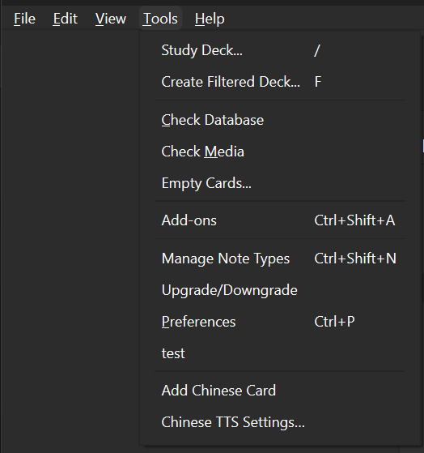
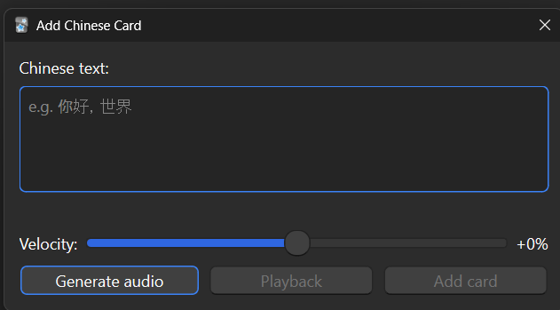
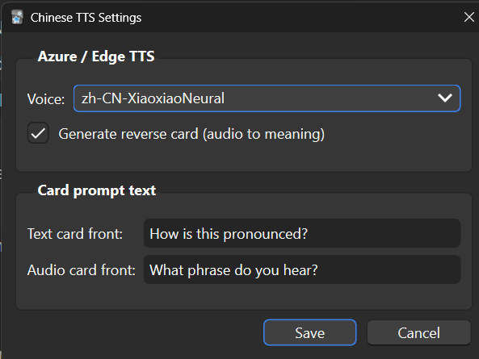

# anki-zh

An Anki add-on for learners of Mandarin Chinese. It lets you generate flashcards directly from a Chinese sentence, complete with audio, without leaving Anki.

## Installation

1. Download or clone this repository.
2. Copy the `addon` folder into your Anki add-ons folder (in Anki, go to Tools > Add-ons > Open Add-ons Folder).
3. Restart Anki.

The first time you use the add-on, it will download the dependencies needed for text-to-speech generation (Azure TTS). This only happens once, and it can take a little while depending on your connection.

## How to use it

### Adding a card

Go to Tools > Add Chinese Card. From there you can:

- Type in a Chinese sentence.
- Choose the playback speed.
- Play the audio to check the pronunciation before adding the card.
- Confirm to add the card to whichever deck is currently active.

### Settings

The add-on's settings let you adjust:

- The voice used for the audio.
- Whether an inverse card (audio to Chinese text) is generated alongside the standard one.
- The text shown on the front of the card.
- The text shown on the back of the card.